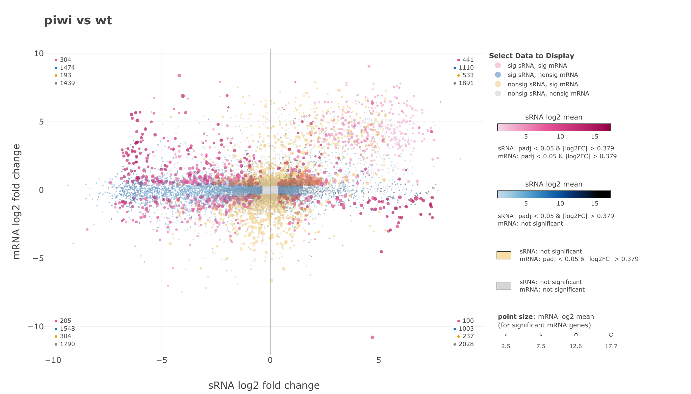
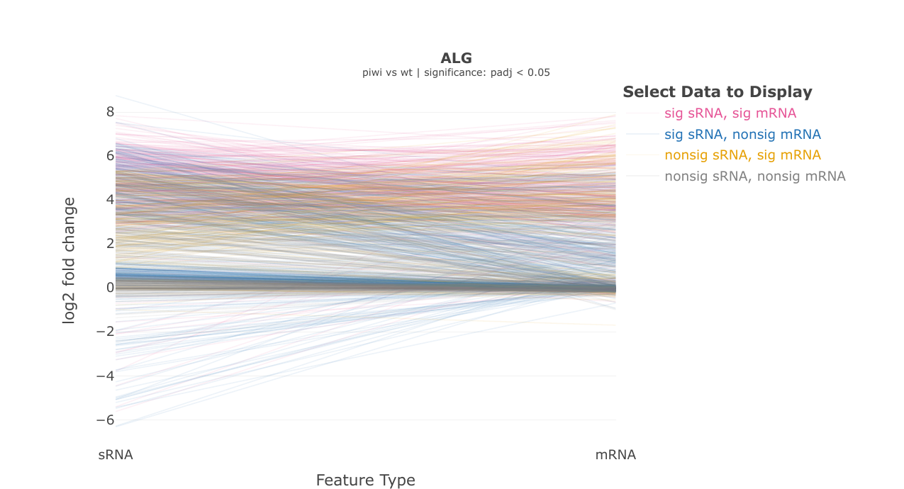

# RNA-Integrate: Integrative Pipeline for Parallel mRNA and Small RNA Data

## Table of Contents

-   [Introduction](#introduction)
-   [Installation](#installation)
-   [Configuration Files](#configuration-files)
    -   [Integrative Parameters YAML](#integrative-parameters-yaml)
    -   [Metadata CSV](#metadata-csv)
    -   [Gene Table](#gene-table)
    -   [Class Parameters CSV](#class-parameters-csv)
-   [Output Files](#output-files)
    -   [DESeq2 Outputs](#deseq2-outputs)
    -   [Integrative Results Tables](#integrative-results-tables)
    -   [Cosmic Plots](#cosmic-plots)
    -   [Slope Plots](#slope-plots)
    -   [Statistical Analysis](#statistical-analysis)
-   [Authors](#authors)

## Introduction {#introduction}

Welcome to the RNA-Integrate R Markdown pipeline by the Montgomery Lab at Colorado State University. This pipeline combines differential expression results from matched small RNA and mRNA sequencing experiments to evaluate small RNA–mRNA target relationships.

The integrative workflow first runs the DESeq2 pipeline separately for the small RNA and mRNA datasets. The resulting differential expression objects are then combined using a user-supplied gene table that defines small RNA IDs, small RNA names, small RNA classes, mRNA target IDs, and mRNA target names.

For each comparison shared between the small RNA and mRNA experiments, the pipeline generates integrative results tables, cosmic plots, slope plots, and statistical summaries.

The pipeline can be executed in RStudio using:

``` r
rmarkdown::render("RNA_Integrate.Rmd", params = yaml::read_yaml("int_params.yml"))
```

Or from the command line using:

``` bash
R -e 'rmarkdown::render("RNA_Integrate.Rmd", params = yaml::read_yaml("int_params.yml"))'
```

Execution time depends on dataset size, selected outputs, and whether PDF exports are generated for interactive plots.

## Installation {#installation}

This pipeline requires R and several CRAN/Bioconductor packages. The integrative script checks for required packages before running and will stop with an informative message if a package is missing.

The following CRAN packages are used by the integrative pipeline:

-   knitr
-   rmarkdown
-   yaml
-   plotly
-   htmlwidgets
-   htmltools
-   DT
-   webshot2
-   ggplot2
-   pagedown
-   pdftools

The DESeq2 subpipeline also uses the packages required by the standalone DESeq2 workflow, including:

-   tximport
-   DESeq2
-   heatmaply

If package installation fails because of version or dependency issues, install the problem package manually in RStudio or from the command line.

To install a CRAN package manually:

``` r
install.packages("PackageName")
```

To install Bioconductor packages manually:

``` r
install.packages("BiocManager")
BiocManager::install("DESeq2")
BiocManager::install("tximport")
```

Some PDF exports require Chrome or Chromium through the `pagedown` package. If Chrome is unavailable, the pipeline will still run but may skip PDF export for some interactive plots.

## Configuration Files {#configuration-files}

### Integrative Parameters YAML {#integrative-parameters-yaml}

The integrative parameters YAML file controls the mRNA run, small RNA run, and integrative analysis. A template parameters file can be viewed here: [template_int_params.yml](template_int_params.yml).

The following parameters are read during pipeline execution.

#### Run Identity

-   `mrna_experiment_id`: Short experiment name for the mRNA DESeq2 run.
-   `small_rna_experiment_id`: Short experiment name for the small RNA DESeq2 run.
-   `integrative_experiment_id`: Short experiment name for the integrative run.

These values are used in output directory and file names.

#### Software Methods

-   `mrna_software_method`: Count input type for the mRNA dataset. Options include:
    -   `counts_matrix`
    -   `rsem`
    -   `htseq`
    -   `salmon`
    -   `kallisto`
-   `small_rna_software_method`: Count input type for the small RNA dataset. Options include:
    -   `counts_matrix`
    -   `tiny_rna`

#### Input Data

-   `mrna_counts_matrix`: Path to the mRNA counts matrix. This can be left blank for file-based methods that rely on `counts_file` values in the mRNA metadata.
-   `small_rna_counts_matrix`: Path to the small RNA counts matrix or tinyRNA output table.
-   `mrna_metadata`: Path to the mRNA metadata CSV.
-   `small_rna_metadata`: Path to the small RNA metadata CSV.

#### Gene Table {#gene-table}

-   `mrna_gene_table_method`: Gene table format for the mRNA DESeq2 run. Options include:
    -   `full_table`
    -   `common_names_only`
    -   `gene_class_only`
    -   `no_table`
-   `small_rna_gene_table_method`: Gene table format for the small RNA DESeq2 run. Options include:
    -   `full_table`
    -   `common_names_only`
    -   `gene_class_only`
    -   `no_table`
-   `gene_table`: Path to the integrative gene table. This file is required for the integrative analysis.

#### Core Output Toggles

These parameters control outputs generated by the mRNA and small RNA DESeq2 subpipeline runs:

-   `generate_results_tables`: `TRUE` or `FALSE`. Render and save DESeq2 results tables.
-   `generate_pca`: `TRUE` or `FALSE`. Render and save PCA plots.
-   `generate_intra_condition`: `TRUE` or `FALSE`. Render and save intra-condition replicate scatterplots.
-   `generate_mean_reads`: `TRUE` or `FALSE`. Render and save mean reads scatter plots.
-   `generate_ma`: `TRUE` or `FALSE`. Render and save MA plots.
-   `generate_heatmap`: `TRUE` or `FALSE`. Render and save heatmaps.

#### Integrative Output Toggles

These parameters control outputs generated by the integrative portion of the pipeline:

-   `generate_integrative_results_tables`: `TRUE` or `FALSE`. Render and save integrative results tables.
-   `generate_cosmic_plots`: `TRUE` or `FALSE`. Render and save cosmic plots.
-   `generate_slope_plots`: `TRUE` or `FALSE`. Render and save slope plots.
-   `generate_statistical_analysis`: `TRUE` or `FALSE`. Render and save statistical analysis tables.

#### Mean Reads Interactive Behavior

-   `save_mean_reads_interactive`: `TRUE` or `FALSE`. Save interactive HTML versions of mean reads scatter plots from the DESeq2 subpipeline runs.

#### Significance and Styling Thresholds

-   `p_value_threshold`: Adjusted p-value threshold used to classify statistically significant genes or target pairs.
-   `fold_change_threshold`: Fold-change threshold used to classify statistically significant genes or target pairs.
-   `lower_transparency`: Alpha value for non-significant genes in DESeq2 mean reads plots.
-   `upper_transparency`: Alpha value for significant genes in DESeq2 mean reads plots.

#### Class-Based Styling

-   `customize_by_class`: `TRUE` or `FALSE`. If `TRUE`, point colors and sizes can be customized by gene class when class information is available.
-   `customize_by_significance`: `TRUE` or `FALSE`. If `TRUE`, non-significant genes are colored grey while significant genes retain class-based coloring.
-   `mrna_class_parameters`: Path to the mRNA class parameters CSV.
-   `small_rna_class_parameters`: Path to the small RNA class parameters CSV.

If a class parameters file is left blank and class customization is enabled, a default class parameters file is generated automatically.

#### Heatmap Configuration

-   `heatmap_type`: Heatmap type for the DESeq2 subpipeline runs. Options include:
    -   `complete`
    -   `all_classes`
    -   `selected_classes`
-   `heatmap_selected_classes`: Comma-separated list of classes to display when `heatmap_type` is set to `selected_classes`.

#### Integrative Analysis Settings

-   `cross_comparisons`: Comma-separated list of comparison IDs to analyze. Comparison IDs should match the format generated by the DESeq2 subpipeline, such as `treatment_vs_control`.

If `cross_comparisons` is left blank, the pipeline automatically uses comparisons present in both the small RNA and mRNA DESeq2 result sets.

-   `slope_plot_classes`: Comma-separated list of small RNA classes to include in slope plots.

If `slope_plot_classes` is left blank, all small RNA classes in the gene table are used.

## Metadata CSV {#metadata-csv}

The mRNA and small RNA metadata CSV files describe the experimental design for each DESeq2 subpipeline run.

Each metadata file must contain the following columns:

| counts_file | sample_name | condition | control |
|-------------|-------------|-----------|---------|
| counts1.txt | wt_1        | wt        | TRUE    |
| counts2.txt | wt_2        | wt        | TRUE    |
| counts3.txt | mutant_1    | mutant    | FALSE   |
| counts4.txt | mutant_2    | mutant    | FALSE   |

### Column Descriptions

-   `counts_file`: Count file name or path for file-based methods such as HTSeq, RSEM, Salmon, or Kallisto. For counts matrices or tinyRNA tables, this column can contain placeholder or null values.
-   `sample_name`: Sample or replicate name. For counts matrices and tinyRNA tables, these values must match the count-column names.
-   `condition`: Experimental condition for each sample.
-   `control`: `TRUE` or `FALSE`, indicating whether the sample belongs to the control condition.

If exactly one condition is marked as the control group, contrasts are generated as each non-control condition versus the control. If no control group or multiple control groups are marked, all pairwise contrasts are generated.

A template metadata file can be viewed here: [template_metadata.csv](template_metadata.csv).

## Gene Table

The gene table is required for the integrative analysis because it defines the small RNA–mRNA target relationships used to combine the DESeq2 results.

The integrative gene table must contain the following columns:

| sRNA_ID        | sRNA_Name  | sRNA_Class | Target_ID      | Target_Name |
|----------------|------------|------------|----------------|-------------|
| WBGene00000001 | smallRNA_1 | miRNA      | WBGene00000002 | target_1    |
| WBGene00000003 | smallRNA_2 | piRNA      | WBGene00000004 | target_2    |

### Required Columns

-   `sRNA_ID`: Small RNA identifier. Values must match IDs in the small RNA count data after processing.
-   `sRNA_Name`: Display name for the small RNA.
-   `sRNA_Class`: Class assigned to the small RNA.
-   `Target_ID`: mRNA target identifier. Values must match IDs in the mRNA count data after processing.

### Optional Column

-   `Target_Name`: Display name for the mRNA target.

If `Target_Name` is missing, the pipeline automatically uses `Target_ID` as the target name. If `Target_Name` is present but contains blank values, those blank values are filled with the corresponding `Target_ID`.

Only target pairs with valid small RNA and mRNA identifiers are retained for integrative analysis. If no valid target pairs are found, the pipeline stops with an informative error.

A template gene table can be viewed here: [template_gene_table.csv](template_gene_table.csv).

## Class Parameters CSV {#class-parameters-csv}

Class parameters CSV files are used to customize mean reads scatter plots in the individual mRNA and small RNA DESeq2 subpipeline runs.

Separate class parameters files can be supplied for the mRNA and small RNA datasets:

-   `mrna_class_parameters`
-   `small_rna_class_parameters`

The class parameters CSV should contain:

| point_class | point_colors | point_sizes |
|-------------|--------------|-------------|
| miRNA       | #D95F02      | 0.7         |
| piRNA       | #1B9E77      | 0.5         |

### Column Descriptions

-   `point_class`: Class name matching a class in the gene table or tinyRNA input.
-   `point_colors`: Hex color value used for that class.
-   `point_sizes`: Numeric point size used for that class.

If a class parameters file is supplied, only genes belonging to classes listed in the file are plotted in the corresponding mean reads scatter plots.

A template class parameters file can be viewed here: [template_class_parameters.csv](template_class_parameters.csv).

## Output Files {#output-files}

The integrative pipeline creates separate outputs for the small RNA DESeq2 run, the mRNA DESeq2 run, and the integrative analysis.

The integrative output directory contains selected tables, plots, interactive HTML files, PDF exports, and a copy of the integrative parameters YAML used for the run.

## DESeq2 Outputs {#deseq2-outputs}

The pipeline first runs the DESeq2 report separately for the small RNA and mRNA datasets. These subpipeline runs can generate:

-   results tables
-   PCA plots
-   intra-condition scatterplots
-   mean reads scatter plots
-   MA plots
-   heatmaps
-   optional interactive mean reads plots

For detailed descriptions of these outputs, see the [Markdown Pipeline README](../Markdown_Pipeline/README.md).

## Integrative Results Tables {#integrative-results-tables}

Integrative results tables summarize differential expression metrics for each valid small RNA–mRNA target pair.

Included columns are:

-   `sRNA`
-   `sRNA_class`
-   `sRNA_mean`
-   `sRNA_log2_FC`
-   `sRNA_padj`
-   `mRNA`
-   `mRNA_mean`
-   `mRNA_log2_FC`
-   `mRNA_padj`

The tables are saved as CSV files and rendered inside the knitted HTML report as interactive DT tables.

[View Example Integrative Results Table CSV](../Demo/Integrative_Demo_Results/integrative_demo_data.csv)

## Cosmic Plots {#cosmic-plots}

Cosmic plots visualize fold-change relationships between small RNAs and their corresponding mRNA targets.

The x-axis shows small RNA log2 fold change, and the y-axis shows mRNA log2 fold change. Each point represents one small RNA–mRNA target pair.

Points are grouped by significance status:

-   significant small RNA and significant mRNA
-   significant small RNA and non-significant mRNA
-   non-significant small RNA and significant mRNA
-   non-significant small RNA and non-significant mRNA

The plot legend can be used to select which data groups are displayed. Hover text provides target-pair information, including small RNA name, small RNA class, mRNA target name, and mRNA target ID.

Cosmic plots are saved as interactive HTML files and exported as PDFs when Chrome is available.



## Slope Plots {#slope-plots}

Slope plots visualize fold-change relationships between small RNAs and their corresponding mRNA targets using paired line segments.

Each line connects the small RNA log2 fold change to the mRNA log2 fold change for one target pair. Slope plots are grouped by selected small RNA classes using the `slope_plot_classes` YAML parameter.

Lines are colored by significance group using the same four categories as the cosmic plot. Line opacity is adjusted based on the number of target pairs in a class so that larger classes are more transparent.

The plot legend can be used to select which significance groups are displayed. Hover text provides target-pair information, including fold-change, mean expression, adjusted p-values, and feature class.

Slope plots are saved as interactive HTML files and exported as PDFs when Chrome is available.



## Statistical Analysis {#statistical-analysis}

The statistical analysis evaluates whether inverse-direction target pairs occur more frequently than expected.

Inverse relationships are defined as small RNA–mRNA target pairs with opposite log2 fold-change directions. Direct relationships are defined as target pairs with matching fold-change directions.

For the sign test, both the small RNA and corresponding mRNA must pass the selected adjusted p-value and fold-change thresholds. A one-sided binomial sign test is then performed to test whether inverse-direction target pairs occur more often than expected under equal proportions of inverse and direct relationships.

The statistical analysis table is saved as a CSV file and rendered inside the knitted HTML report.

[View Example Sign Test CSV](../Demo/Integrative_Demo_Results/integrative_demo_sign_test.csv)

## Authors {#authors}

-   **Dr. Taiowa Montgomery** - 05/2021-present - Colorado State University - [taimontgomery](https://github.com/taimontgomery)
-   **Spencer Kuhn** - 06/2021-present - Colorado State University - [smcguirekuhn](https://github.com/smcguirekuhn)
-   **Paige Lillibridge** - 2025-present - Colorado State University - [paigelily](https://github.com/paigelily)
