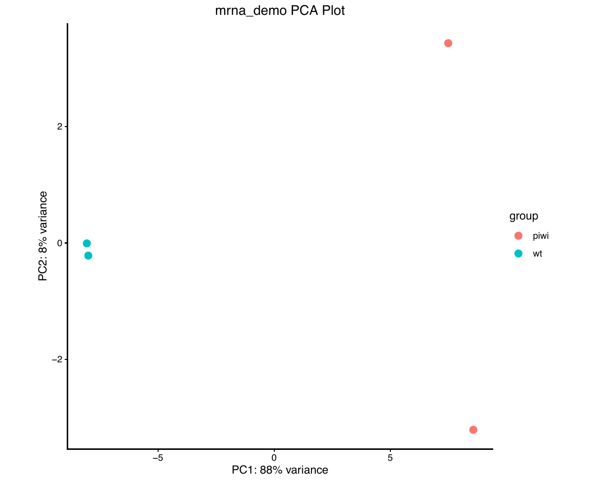
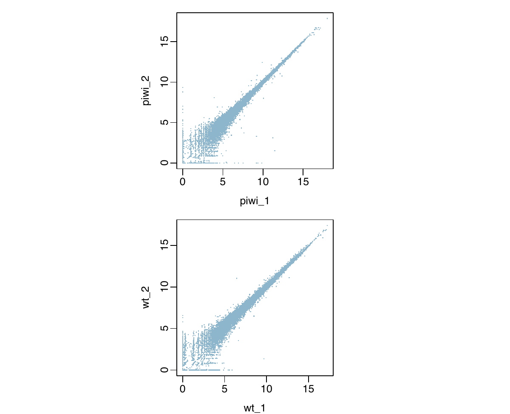
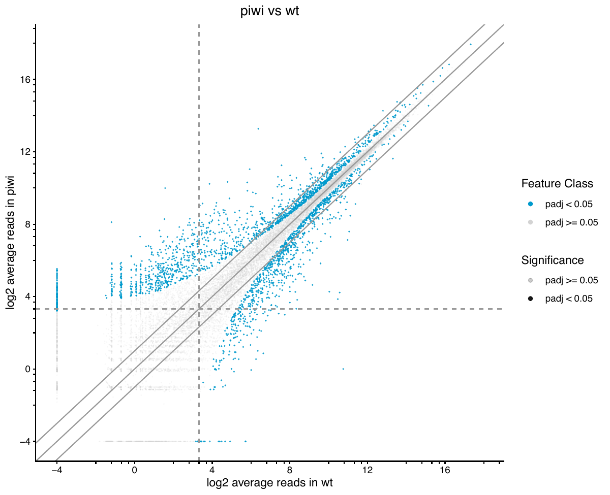
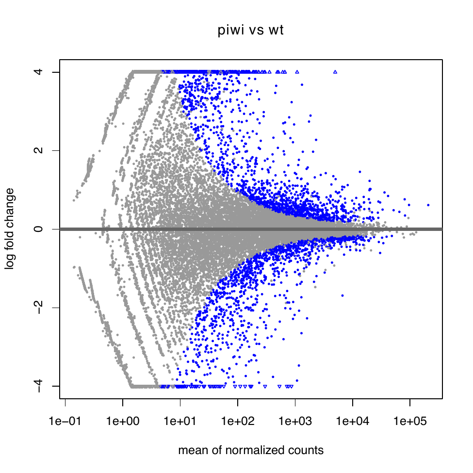
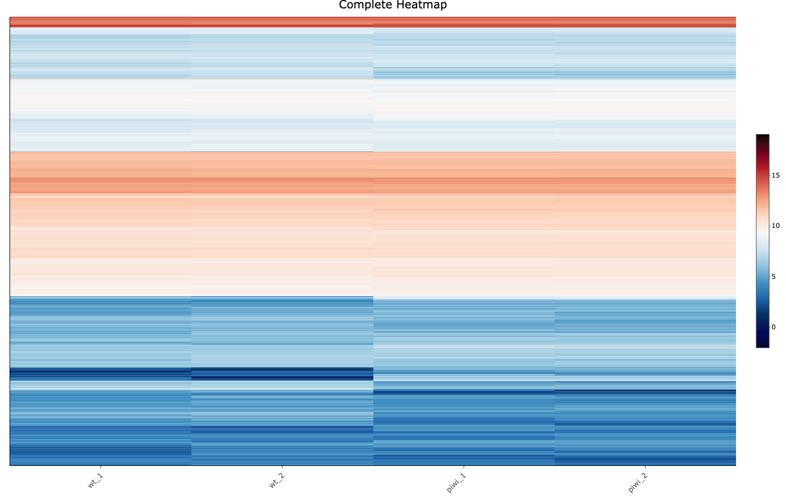

# Montgomery R Markdown Pipeline for mRNA and small RNA DGE Experiments

## Table of Contents

-   [Introduction](#introduction)
-   [Installation](#installation)
-   [Configuration Files](#configuration-files)
    -   [Parameters YAML](#parameters-yaml)
    -   [Metadata CSV](#metadata-csv)
    -   [Gene Table](#gene-table)
    -   [Class Parameters CSV](#class-parameters-csv)
-   [Output Files](#output-files)
    -   [Results Tables](#results-tables)
    -   [PCA Plot](#pca-plot)
    -   [Intra-Condition Scatter Plot](#intra-condition-scatter-plot)
    -   [Mean Reads Scatter Plots](#mean-reads-scatter-plots)
    -   [MA Plots](#ma-plots)
    -   [Heatmap](#heatmap)
-   [Authors](#authors)

## Introduction {#introduction}

Welcome to the R Markdown DESeq2 pipeline by the Montgomery Lab at Colorado State University. This pipeline uses tabulated count files from mRNA or small RNA sequencing experiments to produce differential gene expression (DGE) results, tables, and visualizations.

The pipeline can be used for either mRNA or small RNA experiments. Supported input formats include standard counts matrices, tinyRNA output tables, HTSeq count files, RSEM, Salmon, and Kallisto outputs.

In addition to a knitted HTML report, the pipeline saves selected PDF, CSV, and HTML output files to a timestamped output folder in the working directory. A copy of the parameters YAML used for the run is also saved with the results.

The pipeline can be executed in RStudio using:

``` r
rmarkdown::render("DESeq2_Report.Rmd", params = yaml::read_yaml("params.yml"))
```

Or from the command line using:

``` bash
R -e 'rmarkdown::render("DESeq2_Report.Rmd", params = yaml::read_yaml("params.yml"))'
```

Execution time depends on dataset size, selected outputs, and whether interactive plots are rendered or saved.

## Installation {#installation}

This pipeline requires R and several CRAN/Bioconductor packages. Missing packages are installed automatically within the R Markdown script when possible.

The following CRAN packages are used:

-   knitr
-   DT
-   ggplot2
-   heatmaply
-   plotly
-   yaml
-   htmlwidgets

The following Bioconductor packages are used:

-   tximport
-   DESeq2

If package installation fails because of version or dependency issues, install the problem package manually in RStudio or from the command line.

To install a CRAN package manually:

``` r
install.packages("PackageName")
```

To install Bioconductor packages manually:

``` r
install.packages("BiocManager")
BiocManager::install("DESeq2")
BiocManager::install("tximport")
```

## Configuration Files {#configuration-files}

### Parameters YAML {#parameters-yaml}

The parameters YAML file controls input paths, analysis settings, plot options, and output toggles. A template parameters file can be viewed here: [template_deseq2_params.yml](template_deseq2_params.yml).

The following parameters are read during pipeline execution.

#### Run Identity

-   `experiment_id`: Short experiment name with no spaces. This value is used in the output directory and file names.

#### Input Data

-   `software_method`: Count input type. Options include:

    -   `counts_matrix`
    -   `tiny_rna`
    -   `rsem`
    -   `htseq`
    -   `salmon`
    -   `kallisto`

-   `counts_matrix`: Path to the counts matrix or tinyRNA output table. Leave blank when using file-based methods that rely on `counts_file` values in the metadata.

-   `metadata`: Path to the metadata CSV file.

-   `gene_table_method`: Gene table format. Options include:

    -   `full_table`
    -   `common_names_only`
    -   `gene_class_only`
    -   `no_table`

-   `gene_table`: Path to the gene table CSV file. This can be left blank if `gene_table_method` is set to `no_table`.

#### Core Output Toggles

-   `generate_results_tables`: `TRUE` or `FALSE`. Render and save differential expression results tables.
-   `generate_pca`: `TRUE` or `FALSE`. Render and save the PCA plot.
-   `generate_intra_condition`: `TRUE` or `FALSE`. Render and save intra-condition replicate scatterplots.
-   `generate_mean_reads`: `TRUE` or `FALSE`. Render and save mean reads scatter plots.
-   `generate_ma`: `TRUE` or `FALSE`. Render and save MA plots.
-   `generate_heatmap`: `TRUE` or `FALSE`. Render and save the heatmap.

#### Mean Reads Interactive Behavior

-   `save_mean_reads_interactive`: `TRUE` or `FALSE`. Save interactive HTML versions of mean reads scatter plots to the output folder.
-   `render_mean_reads_interactive`: `TRUE` or `FALSE`. Render interactive mean reads plots directly inside the knitted HTML report.

#### Significance and Styling Thresholds

-   `p_value_threshold`: Adjusted p-value threshold used to classify statistically significant genes.
-   `fold_change_threshold`: Fold-change threshold used to classify statistically significant genes.
-   `lower_transparency`: Alpha value for non-significant genes.
-   `upper_transparency`: Alpha value for significant genes.

#### Class-Based Styling

-   `customize_by_class`: `TRUE` or `FALSE`. If `TRUE`, point colors and sizes can be customized by gene class when class information is available.
-   `customize_by_significance`: `TRUE` or `FALSE`. If `TRUE`, non-significant genes are colored grey while significant genes retain class-based coloring.
-   `class_parameters`: Path to a class parameters CSV. If left blank and class customization is enabled, a default class parameters file is generated automatically.

#### Heatmap Configuration

-   `heatmap_type`: Heatmap type. Options include:
    -   `complete`
    -   `all_classes`
    -   `selected_classes`
-   `heatmap_selected_classes`: Comma-separated list of classes to display when `heatmap_type` is set to `selected_classes`.

## Metadata CSV {#metadata-csv}

The metadata CSV describes the experimental design and connects samples to their count files or count matrix columns.

The metadata file must contain the following columns:

| counts_file | sample_name | condition | control |
|-------------|-------------|-----------|---------|
| counts1.txt | wt_1        | wt        | TRUE    |
| counts2.txt | wt_2        | wt        | TRUE    |
| counts3.txt | mutant_1    | mutant    | FALSE   |
| counts4.txt | mutant_2    | mutant    | FALSE   |

### Column Descriptions

-   `counts_file`: Count file name or path for file-based methods such as HTSeq, RSEM, Salmon, or Kallisto. For counts matrices or tinyRNA tables, this column can contain placeholder or null values.
-   `sample_name`: Sample or replicate name. For counts matrices and tinyRNA tables, these values must match the count-column names.
-   `condition`: Experimental condition for each sample.
-   `control`: `TRUE` or `FALSE`, indicating whether the sample belongs to the control condition.

If exactly one condition is marked as the control group, contrasts are generated as each non-control condition versus the control. If no control group or multiple control groups are marked, all pairwise contrasts are generated.

A template metadata file can be viewed here: [template_metadata.csv](template_metadata.csv).

## Gene Table {#gene-table}

The gene table is optional for standalone DESeq2 runs but is required for common-name conversion and class-based customization.

To disable the gene table, set:

``` yaml
gene_table_method: "no_table"
```

### Gene Table Methods

-   `full_table`: Uses both common names and class annotations.
-   `common_names_only`: Uses common names only.
-   `gene_class_only`: Uses class annotations only.
-   `no_table`: Runs without a gene table.

### Full Gene Table Format

For `full_table`, the gene table should contain at least three columns:

| Gene_ID        | Public_Name | Class |
|----------------|-------------|-------|
| WBGene00000001 | aap-1       | gene  |
| WBGene00000002 | aat-1       | gene  |

The first column should contain gene IDs matching the count table. The second column should contain the display name or common name. The third column should contain the gene or feature class.

### Common Names Only Format

For `common_names_only`, the gene table should contain:

| Gene_ID        | Public_Name |
|----------------|-------------|
| WBGene00000001 | aap-1       |
| WBGene00000002 | aat-1       |

### Gene Class Only Format

For `gene_class_only`, the gene table should contain:

| Gene_ID        | Class |
|----------------|-------|
| WBGene00000001 | gene  |
| WBGene00000002 | gene  |

### tinyRNA Gene Table Behavior

When `software_method` is set to `tiny_rna`, the pipeline automatically builds the gene table from the tinyRNA annotation columns. A separate gene table is not required for tinyRNA runs.

tinyRNA input tables must contain annotation columns matching:

-   `Feature ID`, `Feature.ID`, or `Feature_ID`
-   `Feature Name`, `Feature.Name`, or `Feature_Name`
-   `Classifier`, `Feature Class`, `Feature.Class`, or `Feature_Class`

The pipeline standardizes these columns internally and uses them for common-name and class-based visualization.

A template gene table can be viewed here: [template_gene_table.csv](template_gene_table.csv).

## Class Parameters CSV {#class-parameters-csv}

The class parameters CSV is used to customize mean reads scatter plots by gene or feature class.

A gene table with class information must be available for this file to be used. If a class parameters file is supplied, only genes belonging to classes listed in the file are plotted in the mean reads scatter plots.

The class parameters CSV should contain:

| point_class | point_colors | point_sizes |
|-------------|--------------|-------------|
| miRNA       | #D95F02      | 0.7         |
| piRNA       | #1B9E77      | 0.5         |

### Column Descriptions

-   `point_class`: Class name matching a class in the gene table or tinyRNA input.
-   `point_colors`: Hex color value used for that class.
-   `point_sizes`: Numeric point size used for that class.

If `customize_by_class` is `TRUE` and `class_parameters` is left blank, the pipeline automatically generates a default class parameters CSV containing all detected classes.

A template class parameters file can be viewed here: [template_class_parameters.csv](template_class_parameters.csv).

## Output Files {#output-files}

The pipeline creates a timestamped output directory using the following naming pattern:

``` text
YYYY-MM-DD_HH-MM-SS_experiment_id_output
```

The output directory contains selected tables, plots, interactive HTML files, and a copy of the parameters YAML used for the run.

## Results Tables {#results-tables}

Results tables report normalized counts for each gene across replicates within a contrast, along with fold-change values and adjusted p-values from DESeq2.

When common names and/or class annotations are available, these are included in the results tables.

Results tables are:

-   saved as CSV files
-   rendered inside the knitted HTML report as interactive DT tables

Interactive tables support sorting, searching, and page-size customization.

[View Example Results Table CSV](../Demo/mRNA_Demo_Results/mrna_demo_Results.csv)

## PCA Plot {#pca-plot}

The PCA plot visualizes the first two principal components derived from transformed count data. Samples are colored by experimental condition.

Clustering of replicates within the same condition indicates consistency among biological replicates, while separation between conditions reflects broader expression differences.

The PCA plot is saved as a PDF and rendered in the knitted HTML report when enabled.



## Intra-Condition Scatter Plot {#intra-condition-scatter-plot}

Intra-condition scatterplots compare log2-transformed normalized counts between pairs of biological replicates within each condition.

Counts below one are set to one before log2 transformation to avoid undefined values. Points clustering along the diagonal indicate strong agreement between replicates.

The intra-condition scatterplot output is saved as a PDF and rendered in the knitted HTML report when enabled.



## Mean Reads Scatter Plots {#mean-reads-scatter-plots}

Mean reads scatter plots display average log2 normalized counts across biological replicates for each pair of experimental conditions in a contrast. Each point represents a gene or feature.

Guidelines are included to help visualize expression differences between conditions. Significance is determined using both the adjusted p-value threshold and fold-change threshold.

Mean reads scatter plots can be customized using:

-   adjusted p-value threshold
-   fold-change threshold
-   transparency settings
-   class-based colors
-   class-based point sizes
-   significance-based grey coloring for non-significant genes

When no class information is available, points are colored by significance. When class information is available, points can be colored and sized by class.

Mean reads scatter plots are saved as PDFs when enabled. Interactive HTML versions can also be saved and/or rendered in the knitted report using:

``` yaml
save_mean_reads_interactive: TRUE
render_mean_reads_interactive: TRUE
```

Interactive plots support hover text, zooming, and panning.



## MA Plots {#ma-plots}

MA plots are generated using DESeq2 and display log2 fold change as a function of normalized mean count for each contrast.

Genes passing the adjusted p-value threshold are highlighted in blue.

MA plots are saved as PDFs and rendered in the knitted HTML report when enabled.



## Heatmap {#heatmap}

Heatmaps are generated using `heatmaply` and rendered as interactive HTML widgets. Interactive heatmaps support zooming, panning, and hover-text exploration.

The displayed heatmap depends on the selected YAML setting:

-   `complete`
-   `all_classes`
-   `selected_classes`

If class information is unavailable, the pipeline automatically defaults to the complete heatmap.



## Authors {#authors}

-   **Dr. Taiowa Montgomery** - 05/2021-present - Colorado State University - [taimontgomery](https://github.com/taimontgomery)
-   **Spencer Kuhn** - 06/2021-present - Colorado State University - [smcguirekuhn](https://github.com/smcguirekuhn)
-   **Paige Lillibridge** - 2025-present - Colorado State University - [paigelily](https://github.com/paigelily)
